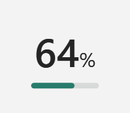

# Codex Quota Mini

在 Windows 版 Codex 左側的「使用額度」按鈕上，直接顯示本週剩餘百分比。數字下方的細線表示剩餘比例。點數字仍會開啟 Codex 原本的額度明細。

## 開始使用

1. 開啟 Microsoft Store 版 Codex，登入可查看週額度的 ChatGPT 帳號。確認主視窗的側欄已出現原生額度按鈕。
2. 到 [Releases](https://github.com/frankchiu-dev/codex-quota-mini/releases/latest) 下載 `codex-quota-mini-windows.zip`，解壓縮到同一個資料夾。
3. 雙擊 `CodexQuota.cmd`，幾秒後就能在頭像上方看見百分比。再雙擊一次即可關閉。下次開啟 Codex 時可手動啟動這個工具。

啟動檔會使用電腦上的 PowerShell 7，也能使用 Codex 執行環境隨附的版本。請讓 `CodexQuota.cmd` 和 `CodexQuotaMini.ps1` 待在同一個資料夾。

## 數字怎麼讀

| 顯示 | 意義 |
| --- | --- |
| `64%` | 示範值。本週額度還剩 64%。 |
| `0%` | 已取得資料，本週額度用完。 |
| `…` | 正在讀取。 |
| `—` | 本次沒有可顯示的週額度。可能是讀取失敗、帳號沒有週額度，或已到重設時間。 |

正常情況下每五分鐘更新一次。若回傳的重設時間更早，會在重設時重新讀取。失敗時等一分鐘再試。

## 運作方式

PowerShell 腳本透過本機 `codex.exe app-server` 的標準輸入與輸出，呼叫公開的 [`account/rateLimits/read` 介面](https://developers.openai.com/codex/app-server)。它取出 Codex 的七天額度，以 `100 − usedPercent` 計算剩餘比例。查詢只讀取額度，不會送出模型請求。

顯示層是一個獨立的 Windows 小視窗。它用 Windows UI Automation 定位 Codex 的額度按鈕，讓滑鼠點擊穿透到原按鈕。只有 Codex 主視窗在前景時顯示。切換到其他程式、最小化、隱藏視窗或找不到按鈕時會隱藏；回到主視窗後恢復。關閉主視窗後工具會退出。這個工具適用於 Windows 主視窗，經繁體中文介面實測；Codex 更新若改了按鈕名稱或位置，可能需要調整定位。

## 授權

[MIT](LICENSE) · 社群獨立專案。

## 開發驗證

在 Windows 執行 `pwsh -NoProfile -STA -File tests/window-lifecycle.ps1`。測試使用隔離的 WPF 視窗、模擬的額度與前景視窗狀態，檢查切換視窗、最小化、隱藏、還原、關閉，以及按鈕暫時消失時的顯示與定位。
